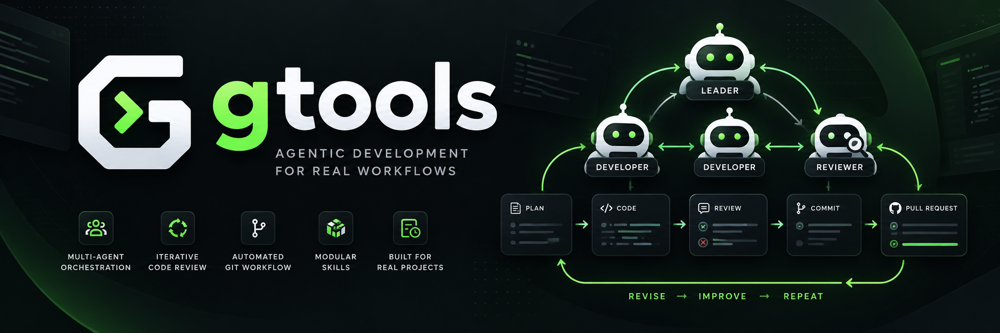
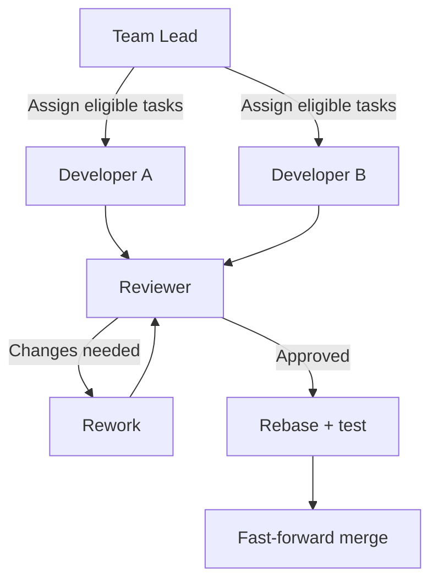
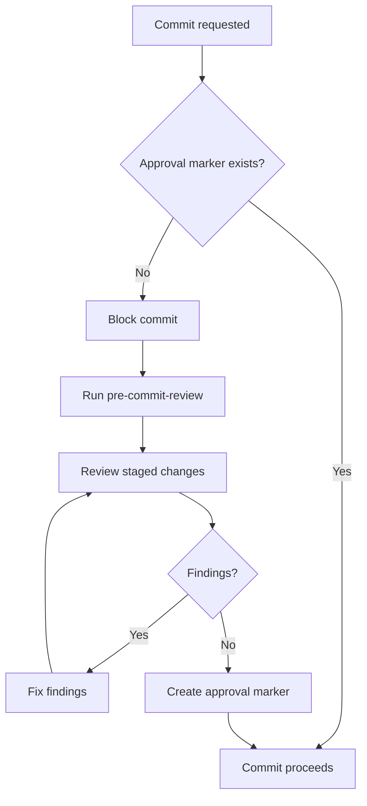
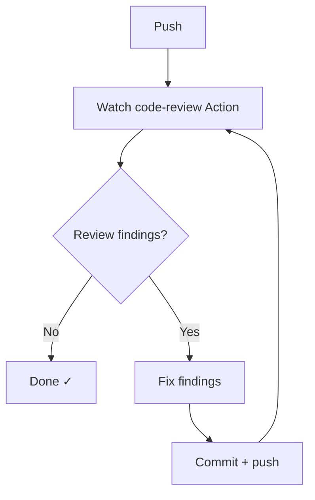

<div align="center">



# gtools

### AI-powered development workflows for Claude Code

**Orchestrate agents · Automate reviews · Streamline Git · Ship with confidence**

[](https://claude.ai/code)
[](LICENSE)
[](https://github.com/argami/gtools)

**[Get started](#quick-start) · [Explore skills](#skills) · [How it works](#automated-review-workflows) · [Contribute](#contributing)**

</div>

---

**gtools** is a collection of seven skills for [Claude Code](https://claude.ai/code). It brings Git and pull-request automation, iterative code reviews, multi-agent task orchestration, and timesheet management into your development workflow.

Designed to reduce repetitive coordination while keeping review gates and explicit approvals where they matter.

## At a glance

| Capability | What it does |
|:--|:--|
| **Multi-agent orchestration** | Coordinate two developers and a reviewer with task dependencies, worktrees, and linear merges. |
| **Review before commit** | Run a review-and-fix loop before allowing a commit. |
| **Review after push** | Watch CI review results, fix reported issues, and push again. |
| **Git and PR utilities** | Squash branches and manage unresolved PR review threads. |
| **Timesheets** | Calculate and submit BambooHR timesheet entries. |
| **Optional semantic decisions** | Use TypeSafe for selected intent and verdict classifications, with fallbacks. |

> [!NOTE]
> The pre-commit and post-push hooks run in an active Claude Code workflow. They are not a replacement for your repository's CI policies or human approval requirements.

## Quick start

### Prerequisites

- [Claude Code](https://claude.ai/code) (CLI or desktop)
- [Git](https://git-scm.com/)
- [GitHub CLI (`gh`)](https://cli.github.com/) for GitHub-related skills

### Install

**Option A — Direct installation (no clone required)**

```bash
claude --plugin-url https://github.com/argami/gtools/archive/refs/heads/main.zip
```

**Option B — Personal plugin marketplace**

Run these commands inside Claude Code:

```text
/plugin marketplace add argami/gtools
/plugin install gtools
```

**Option C — Community marketplace (subject to approval)**

```text
/plugin install gtools@claude-community
```

**Option D — Local development**

```bash
claude --plugin-dir /path/to/gtools
```

**Verify:** Type `/gtools:` in Claude Code. Autocomplete should display the seven available skills.

## Skills

| Skill | Purpose | Invocation |
|:--|:--|:--|
| [**team-lead**](skills/team-lead/README.md) | Run parallel development tasks with Developer-A, Developer-B, and a Reviewer; enforce rebase-only, fast-forward merges. | `/gtools:team-lead tasks.md` |
| [**pre-commit-review**](skills/pre-commit-review/SKILL.md) | Review staged changes, fix issues iteratively, and gate commits. | Automatic hook |
| [**post-push-review**](skills/post-push-review/SKILL.md) | Watch code-review CI, resolve findings, and repeat until clean or user input is required. | Automatic hook |
| [**squash-branch**](skills/squash-branch/README.md) | Consolidate branch commits into one after showing a plan and obtaining approval. | `/gtools:squash-branch` |
| [**list-unresolved-comments**](skills/list-unresolved-comments/SKILL.md) | List unresolved review threads on the current pull request. | `/gtools:list-unresolved-comments` |
| [**resolve-comments**](skills/resolve-comments/SKILL.md) | Resolve unresolved or outdated pull-request review threads in bulk. | `/gtools:resolve-comments` |
| [**update_timesheets**](skills/update_timesheets/README.md) | Submit BambooHR timesheets with automatic shift calculations. | `/gtools:update_timesheets` |

### Example: multi-agent execution

```bash
/gtools:team-lead tasks.md
```

The team-lead skill reads a structured task plan, creates dedicated Git worktrees by default, assigns eligible work to two developer agents, and sends completed work through a reviewer. Approved work is integrated using a **linear, fast-forward-only history**.



**Built-in safeguards:** task dependencies, tests after rebases, serialized merges, and resumable progress checkpoints (`progress.md`).

For the task-file format, worktree options, and recovery behavior, see the [team-lead guide](skills/team-lead/README.md).

## Automated review workflows

Two hooks are registered automatically when the plugin is installed. Both operate in an active Claude Code session.

### Before commit: review gate

**Trigger:** a Bash call to `git commit` or `rtk git commit`.



The hook checks a marker under `/tmp/gtools-review-<sha256-hash>`, derived from the project path and staged diff. The marker must be created in a **separate Bash call** before retrying the commit, because the hook runs at the tool-call boundary.

If the `code-review` skill is unavailable, the workflow permits the commit and reports that no automated review occurred. Unresolvable findings require user direction before proceeding.

### After push: CI review loop

**Trigger:** a Bash call to `git push` or `rtk git push`.



Claude checks the latest `code-review` workflow run for the branch, reads PR findings, applies fixes, and repeats until the review passes cleanly. If an issue cannot be resolved safely, it stops and asks for guidance.

> [!IMPORTANT]
> The post-push workflow expects a GitHub Actions workflow named `code-review`. It does not create or modify your CI configuration, and it is not an unattended background service.

**Hook configuration:** [`hooks/hooks.json`](hooks/hooks.json). Hooks can be disabled through Claude Code settings.

## Configuration and dependencies

| Feature | Requirement |
|:--|:--|
| GitHub and PR skills | Authenticated `gh` CLI with appropriate repository permissions |
| Team orchestration | Claude Code Agent Teams enabled |
| Timesheets | BambooHR credentials saved to `~/.timesheets_config.json` after initial setup |
| TypeSafe integration | Optional `TYPESAFE_API_KEY` environment variable |
| Review hooks | Plugin installed and hooks enabled |

To enable Agent Teams for `team-lead`:

```bash
export CLAUDE_CODE_EXPERIMENTAL_AGENT_TEAMS=1
claude --teammate-mode auto
```

### Optional: TypeSafe

Selected skills integrate with [TypeSafe](https://typesafe.ai) for calibrated semantic decisions rather than relying solely on keyword matching or inferred intent.

```bash
export TYPESAFE_API_KEY=your_key_here
```

| Skill | TypeSafe responsibility | Fallback without API key |
|:--|:--|:--|
| `update_timesheets` | Detect dry-run intent across phrasings and languages | Keyword matching |
| `squash-branch` | Classify commit-message conventions | Infer from Git history |
| `squash-branch` | Interpret user approval or rejection | Yes/no heuristic |
| `team-lead` | Parse reviewer verdicts | Match `APPROVED` / `CHANGES REQUESTED` |

**TypeSafe is optional:** all supported skills retain their fallback behavior.

## Repository structure

```text
gtools/
├── README.md
├── CLAUDE.md
├── .claude-plugin/
│   └── plugin.json
├── hooks/
│   └── hooks.json
└── skills/
    ├── squash-branch/
    ├── resolve-comments/
    ├── list-unresolved-comments/
    ├── pre-commit-review/
    │   └── src/
    │       └── before-commit.sh
    ├── post-push-review/
    │   └── src/
    │       └── after-push.sh
    ├── update_timesheets/
    └── team-lead/
```

The pre-commit script blocks commits without a matching review marker; the post-push script injects review context after pushes. Hook definitions use `${CLAUDE_PLUGIN_ROOT}` to resolve plugin-relative paths.

**Naming convention:** skill directories use kebab-case, except `update_timesheets`, which retains underscores to match `/gtools:update_timesheets`.

## Contributing

Contributions and new skills are welcome.

1. Create `skills/<skill-name>/`.
2. Add a `SKILL.md` with frontmatter metadata and step-by-step instructions.
3. Add a detailed `README.md` for complex skills.
4. Update the version in `.claude-plugin/plugin.json` when publishing.
5. Test the skill via `/gtools:<skill-name>` in Claude Code.

See [CLAUDE.md](CLAUDE.md) for development conventions and skill structure.

## Support

Found an issue or have an idea? [Open a GitHub issue](https://github.com/argami/gtools/issues).

## License

Released under the **MIT License**.
